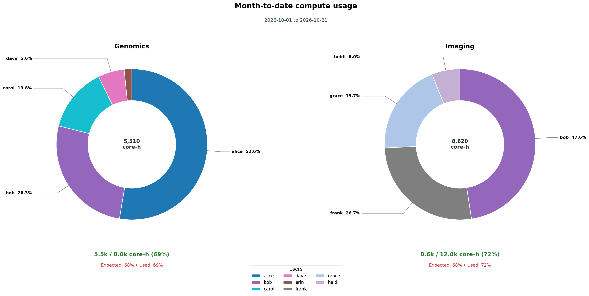
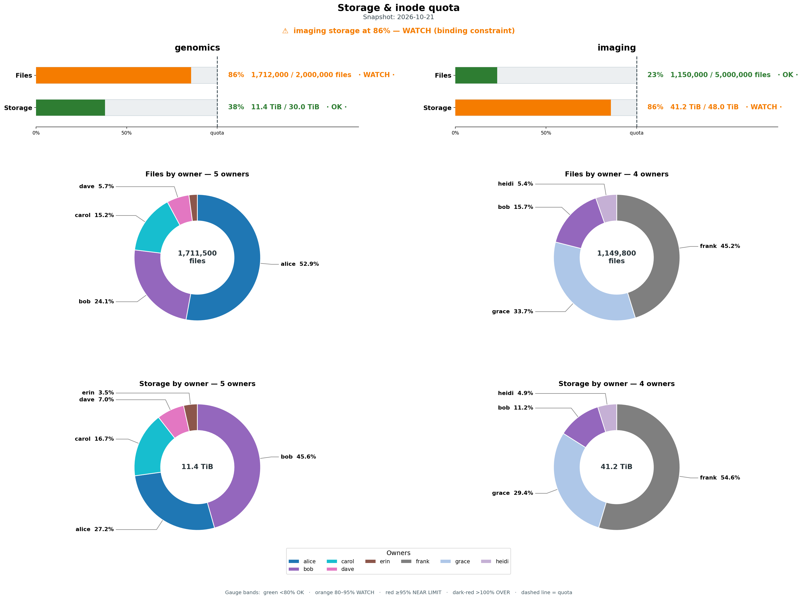

# hpc-digest

Weekly digests of a research group's compute and storage use on an HPC cluster,
posted to Slack as one chart each.

- **compute**: month-to-date core-hours per user for each Slurm account, with
  used vs allocated and whether usage is ahead of the month's pace.
- **storage**: CephFS quota gauges (files and bytes) for each project, plus who
  holds the files and who holds the bytes. The two often differ a lot.

Both run as self-resubmitting Slurm jobs, need no admin rights, and keep each
person's colour the same across weeks and across both charts.

| Compute | Storage |
|---|---|
|  |  |

*Charts made from fake data by `examples/make_examples.py`.*

## Requirements

- Python 3.9 or newer: `pip install -r requirements.txt`
- **compute**: Slurm accounting (`sreport`).
- **storage**: CephFS with quotas on the project directories. Usage and limits
  come from CephFS's own statistics, so a scan takes about a second per project.
- A Slack bot token with the `files:write` and `chat:write` scopes, invited to
  the channel.

## Quick start

```bash
git clone https://github.com/ruqse/hpc-digest && cd hpc-digest
pip install -r requirements.txt
cp config.example.toml config.toml        # then edit: channel, accounts, project paths

# The bot token, in a private file named in config.toml (or $SLACK_BOT_TOKEN).
# read -s keeps it out of your shell history.
mkdir -p ~/.config/hpc-digest
( umask 077; read -rsp 'Slack bot token: ' t && echo "$t" > ~/.config/hpc-digest/slack_token )

# Render locally. Nothing is posted without --post.
python3 -m hpc_digest storage
python3 -m hpc_digest compute

# Then post to a test channel first
python3 -m hpc_digest storage --post --channel C0TESTCHANNEL
```

## Scheduling with Slurm

Each `slurm/*.sbatch` script resubmits itself for the following week, so one
submission starts a weekly chain. Submit from the repository root, and put any
module loads in `slurm/env.sh` (see `slurm/env.example.sh`).

```bash
export HPCD_WATCHDOG=1     # only if you run both reports
sbatch -A <account> --begin="$(date -d 'next Monday 09:00' +%FT%T)"    slurm/compute.sbatch
sbatch -A <account> --begin="$(date -d 'next Wednesday 08:30' +%FT%T)" slurm/storage.sbatch
```

A chain stops silently if a job dies before its first line runs, for example on
a failing node. With `HPCD_WATCHDOG=1`, each report restarts the other when it
has no job queued, so you lose at most one week.

## More

[docs/details.md](docs/details.md) covers how the numbers are computed, the QA
checks, all options, changing the schedule, stopping a chain, and
troubleshooting.

## License

MIT, see [LICENSE](LICENSE).
